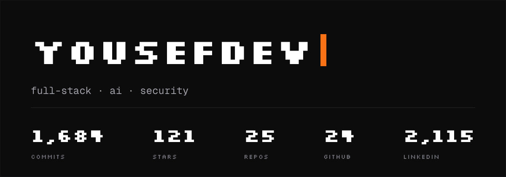

Full-stack developer building web platforms, AI tools and security products. Level 3 Cybersecurity & AI student at Horus University, Egypt. Three-time hackathon winner.

&nbsp;

**Projects**

- [Verdict](https://verdict.run): The Ultimate Competitive Programming Platform.
- [Sast](https://sast.tech): Autonomous AI Security Agent.
- [Acolite](https://acolite.xyz): A polished talent platform frontend built for high-velocity teams.
- [Topy](https://topy.yust.dev): A landing page for a video editor and motion graphics artist.
- [SpaceWorth](https://spaceworth.site): Multimodal AI Real Estate Valuation Engine & CAD Floor-Plan OCR.
- [10K Runner](https://10krunner.fun): Infinite runner game that makes you EARN & fun.

&nbsp;

**Writing**

- [ICPCHUE.com Update: 45 New Achievements](https://yust.dev/blog/icpchue-45-new-achievements-update) · Oct 30, 2026
- [ICPC HUE Orientation Day: One Year of Our Community](https://yust.dev/blog/icpc-hue-orientation-day-season-2027) · Oct 26, 2026
- [Finishing the ITI AI Track: 200+ Hours and 3 Certificates](https://yust.dev/blog/iti-ai-track-completed-three-certificates) · Oct 19, 2026

&nbsp;

**Recently pushed**

- [waddle](https://github.com/YUST777/waddle): Learn web development five minutes a day, with a duck. React + Supabase mobile app.
- [icpchue](https://github.com/YUST777/icpchue): The beating heart of competitive programming at Horus University. A custom-built online judge, comprehensive training platform, and secure execution engine.
- [bataa](https://github.com/YUST777/bataa): Bataa — a friendly app for building real web-development skills through short daily tasks

&nbsp;

**Find me**

[yust.dev](https://yust.dev) · [LinkedIn](https://www.linkedin.com/in/yousefmsm1/) · [X](https://x.com/YUST777) · [Email](mailto:yousfmsm@hotmail.com)

Generated by <code>scripts/gen_profile.mjs</code> and refreshed daily · 2026-11-18
